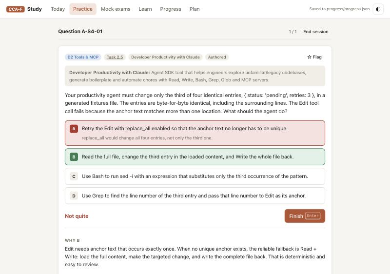
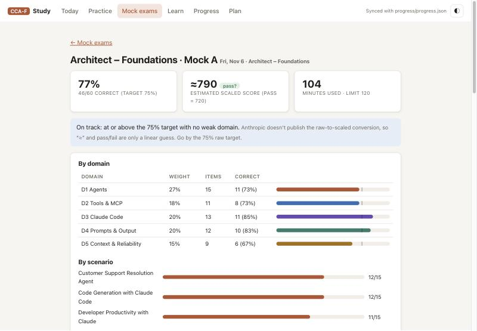
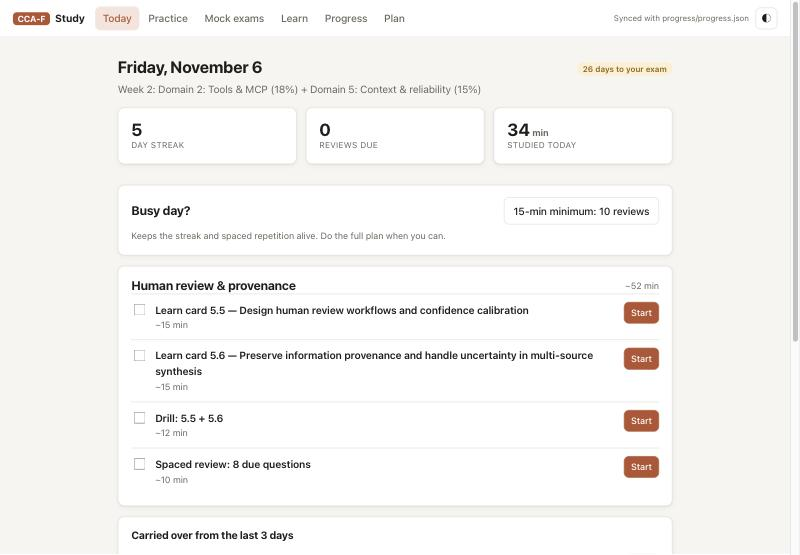
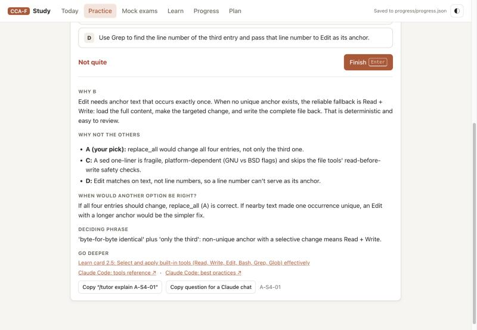
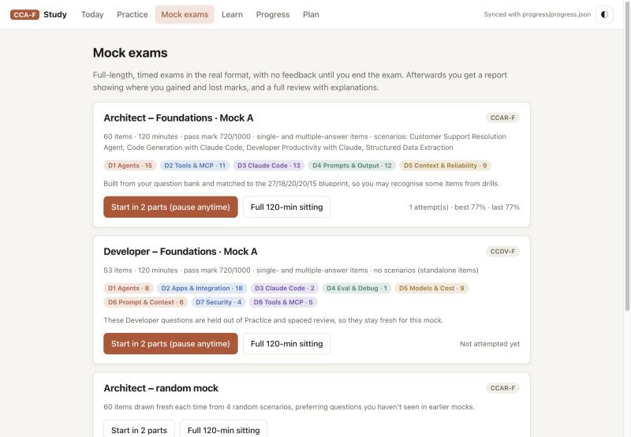
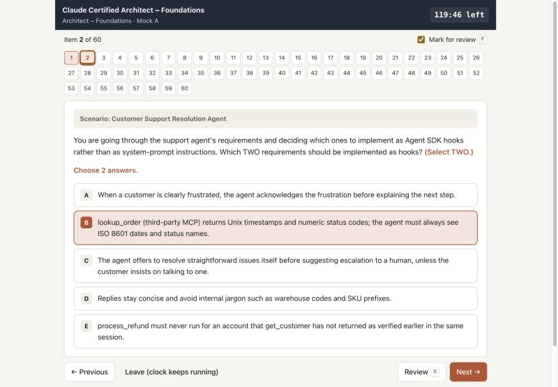
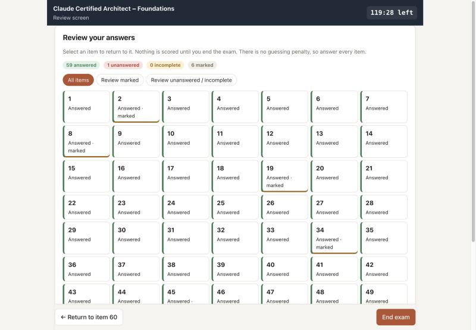
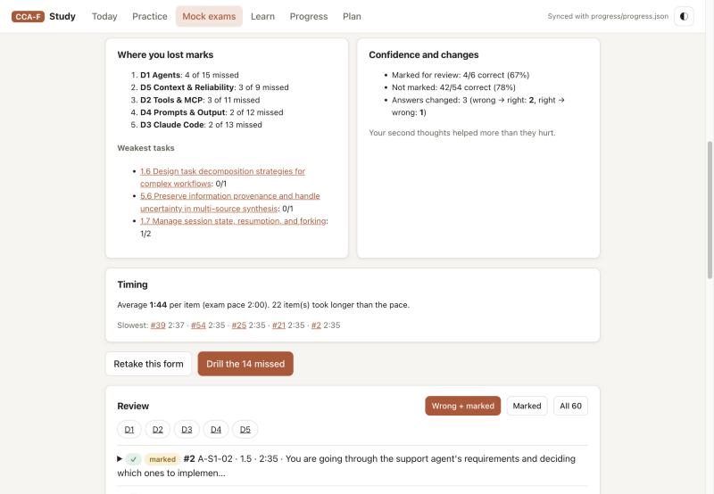

# Claude Certification Study Kit

**A free, local, offline study app for the Anthropic Claude certifications.** It covers **Claude Certified Architect – Foundations (CCAR-F)** and includes a full mock exam for **Claude Certified Developer – Foundations (CCDV-F)**:
- a 148-question practice bank with detailed explanations
- 30 learn cards, one per official task statement
- spaced repetition
- two timed, full-length mock exams with a review screen and a score report
- a 5-week study plan built for people with a day job
- an optional `/tutor` for Claude Code

No account, no API key, no API costs. Everything runs in your browser on your own machine.

[](LICENSE)
[](LICENSE-CONTENT)

-orange.svg)

> [!IMPORTANT]
> **Unofficial, community project.** This kit is not affiliated with, endorsed by, or sponsored by Anthropic. "Claude", "Anthropic" and the certification names belong to Anthropic. The questions and explanations were written for practice and **may contain mistakes**: when in doubt, trust the [official exam guide](#official-exam-and-registration) and the [official docs](#official-documentation). If you find a wrong answer, please [open an issue](https://github.com/sercanerhan/claude-certification-study-kit/issues).

> [!NOTE]
> **Exam-guide version.** The content follows the official exam guides **v1.0 (July 2026)**. Anthropic updated the content of all four exams on **Dec 7, 2026**, and published new exam guides on Nov 17, 2026. If your exam date is after Dec 7, 2026, check the current guide on the [Partner Academy](https://anthropic-partners.skilljar.com/page/partner-certifications) and compare its task list with the Learn tab.

<p align="center">
  
  
</p>

---

## Contents
- [Features](#features)
- [Quick start](#quick-start)
- [The exams covered](#the-exams-covered)
- [How the study plan works](#how-the-study-plan-works)
- [Where the content comes from](#where-the-content-comes-from)
- [Resources and citations](#resources-and-citations)
- [Project layout](#project-layout)
- [Contributing](#contributing)
- [License](#license)
- [Acknowledgements](#acknowledgements)

## Features

| | |
|---|---|
| **Today** | Today's tasks from the plan, each with a Start button. A **15-minute minimum day** button keeps your streak and spaced repetition going on busy days. |
| **Practice** | Drills by domain, task statement, scenario or source. Also: due reviews, your mistakes, flagged questions, your 3 weakest task statements, a 20-question diagnostic, and the 12 official sample questions. |
| **Explanations** | After every answer you see: why the right option wins, why **each** wrong option fails, *when another option would be right*, the deciding phrase in the question, the learn card, and official doc links. |
| **Spaced repetition** | Before checking an answer you mark it *sure*, *unsure* or *guessing*. Wrong answers and lucky guesses come back after 1, 2, 4, 8 and 16 days. |
| **Learn** | 30 cards, one per official task statement: the core idea, what the exam tests, **exam traps**, an example and flashcard bullets. |
| **Mock exams** | Two fixed, full-length mocks in an exam-simulator screen, plus a random Architect mock. Run each as one 120-minute sitting, or in **2 pausable parts**. In parts, the clock only runs while the exam screen is open. |
| **Mock report** | The estimated scaled score and a pass/fail guess against 720, then a breakdown of your result (see below) and a full review with explanations. |
| **Progress** | Accuracy by domain and task statement, readiness against a 75% target, mock history, and study minutes. Export and import your progress. |
| **Plan** | A 5-week schedule with no day longer than 60 minutes. Set your own start date and exam date. |
| **`/tutor`** *(optional)* | A [Claude Code](https://code.claude.com/docs/en/overview) skill. `/tutor explain <question-id>` walks you through a question by asking for your reasoning first. `/tutor 2.3` gives a mini-lesson and 3 new questions. `/tutor quiz hooks` runs a conversational quiz. It reads your progress file. |

The mock report breaks your result down by:
- domain, and by scenario (Architect)
- where you lost marks
- accuracy on marked versus unmarked items
- answers you changed (wrong→right and right→wrong)
- time per item against the exam pace

<p align="center">
  
  
  
  
  
  
</p>

## Quick start

**Requirements**
- Python 3.9+. Standard library only, nothing to `pip install`.
- [`pdftotext`](https://poppler.freedesktop.org/) from Poppler, used to import the official sample questions:
  - macOS: `brew install poppler`
  - Debian/Ubuntu: `sudo apt install poppler-utils`
- A modern browser.
- Optional: [Claude Code](https://code.claude.com/docs/en/overview), for the `/tutor` skill.

**Install and run**

```bash
git clone https://github.com/sercanerhan/claude-certification-study-kit.git
cd claude-certification-study-kit
./start.sh
```

On first run, `./start.sh` does four things:
1. It downloads the sources this repo doesn't redistribute (see [why](#where-the-content-comes-from)) into a local, git-ignored `vendor/` folder:
   - the official exam guides, from Anthropic
   - the community study guide, from GitHub, pinned to one commit
2. It builds the question bank and the mock-exam forms.
3. It serves the app at **http://127.0.0.1:8765** and opens your browser.
4. It saves your progress in your browser and in `progress/progress.json`. Both stay on your machine.

On Windows, run the same steps by hand:

```bash
python tools/setup.py
```

```bash
python serve.py
```

Then open http://127.0.0.1:8765. Keyboard shortcuts:
- `A`–`E` or `1`–`5`: pick an option
- `Enter`: check / next
- `U`: unsure, `G`: guessing, `F`: flag
- in a mock, `←`/`→` to move and `R` for the review screen

If a download fails (no network, or a URL moved), setup warns and the app still runs with every question written for this repo.

## The exams covered

### Claude Certified Architect – Foundations (CCAR-F)
- **Format:** 60 items, single- and multiple-answer, in 120 minutes. 4 of 6 scenarios are chosen at random.
- **Scoring:** a scaled score of 720/1000 passes.
- **Fee and validity:** $125; the credential lasts 12 months.
- **Source:** [official exam guide v1.0](https://everpath-course-content.s3-accelerate.amazonaws.com/instructor%2F6nizmqk8tpzpfjvt6qmmav7rh%2Fpublic%2F1783542750%2FClaude+Certified+Architect+%E2%80%93+Foundations+Exam+Guide.pdf).

| Domain | Weight | In the kit |
|---|---|---|
| 1. Agentic Architecture & Orchestration | 27% | 7 task statements and cards |
| 2. Tool Design & MCP Integration | 18% | 5 |
| 3. Claude Code Configuration & Workflows | 20% | 6 |
| 4. Prompt Engineering & Structured Output | 20% | 6 |
| 5. Context Management & Reliability | 15% | 6 |

The 6 scenarios are:
- Customer Support Resolution Agent
- Code Generation with Claude Code
- Multi-Agent Research System
- Developer Productivity with Claude
- Claude Code for Continuous Integration
- Structured Data Extraction

The kit has at least 19 questions for each scenario.

**Architect Mock A** is a fixed 60-item form built from the bank. It covers 4 scenarios and comes within one item of the blueprint in every domain.

### Claude Certified Developer – Foundations (CCDV-F): mock exam
- **Format:** 53 items, single- and multiple-answer, in 120 minutes, with **no scenarios**.
- **Scoring:** a scaled score of 720/1000 passes.
- **Source:** [official exam guide v1.0](https://everpath-course-content.s3-accelerate.amazonaws.com/instructor%2F6nizmqk8tpzpfjvt6qmmav7rh%2Fpublic%2F1783542875%2FClaude+Certified+Developer+%E2%80%93+Foundations+Exam+Guide.pdf).

| Domain | Weight | Items in Developer Mock A |
|---|---|---|
| 1. Agents and Workflows | 14.7% | 8 |
| 2. Applications and Integration | 33.1% | 18 |
| 3. Claude Code | 3.1% | 2 |
| 4. Eval, Testing, and Debugging | 2.6% | 1 |
| 5. Model Selection and Optimization | 16.8% | 9 |
| 6. Prompt and Context Engineering | 11.0% | 6 |
| 7. Security and Safety | 8.1% | 4 |
| 8. Tools and MCPs | 10.6% | 5 |

**Developer Mock A** is made of the 3 official samples plus 50 questions written to the 25 weighted skills in the guide. Each question was checked against the current docs. These questions are **held out** of Practice and spaced review, so they're new to you when you sit the mock.

> Exams are delivered by Pearson VUE (online proctored or at a test center), and are currently open to organizations in the **Claude Partner Network**. See the [eligibility page](https://anthropic-partners.skilljar.com/page/certification-eligibility).

## How the study plan works
The plan is 5 weeks plus an exam week, built for about an hour a day around a full-time job. Full reasoning is in [STUDY_PLAN.md](STUDY_PLAN.md).
- **No day is longer than 60 minutes**, weekends included. Mocks run in two 30-question parts, on Saturday and Sunday.
- **A busy day still counts:** the 15-minute minimum (10 due reviews) keeps your streak and memory schedule alive.
- **Domain weight sets the order:** D1 (27%) in week 1, D2 + D5 in week 2, D3 in week 3, D4 in week 4. Week 5 goes to your weakest task statements, and week 6 is the exam.
- **Hard topics get extra time:** built-in tools, the Message Batches API, and nullable/enum schema design.
- **Go/no-go rule:** both mocks ≥ 75% raw and no domain below 60%.

Set your **plan start date** and **exam date** on the Plan tab, and every day shifts with them.

## Where the content comes from

| Content | Where it lives | License |
|---|---|---|
| 72 Architect questions written for this kit (all 6 scenarios, including multiple-answer items) | `data/authored/` | CC BY 4.0 |
| 50 Developer mock questions written for this kit | `data/dev/authored/` | CC BY 4.0 |
| 30 learn cards | `notes/` | CC BY 4.0 |
| Tags and deeper explanations for every imported question: why each wrong option fails, when another option would be right, the deciding phrase, and corrections where an answer key conflicts with the official guide | `data/enrichment/`, `data/dev/enrichment/` | CC BY 4.0 |
| App and tools | `app/`, `tools/` | MIT |
| **Fetched on setup, not redistributed:** the official sample questions (12 Architect, 3 Developer) and the exam guides | downloaded from Anthropic into `vendor/` | © Anthropic |
| **Fetched on setup, not redistributed:** 76 community practice questions (64 unique) | downloaded from [paullarionov/claude-certified-architect](https://github.com/paullarionov/claude-certified-architect) into `vendor/` | the community repo has no license |

The community repo has no license, and the exam guides are Anthropic's material. So this repo publishes only what was written for it, and **downloads the rest straight from its original source onto your machine** for personal study. The community guide is pinned to one commit (`946cd28`), so question IDs and explanations stay in sync.

## Resources and citations
The detailed, annotated list is in **[RESOURCES.md](RESOURCES.md)**. The essentials are below. All links were checked in November 2026.

### Official: exam and registration
- **Exam guides v1.0 (July 2026):**
  - [Claude Certified Architect – Foundations (CCAR-F)](https://everpath-course-content.s3-accelerate.amazonaws.com/instructor%2F6nizmqk8tpzpfjvt6qmmav7rh%2Fpublic%2F1783542750%2FClaude+Certified+Architect+%E2%80%93+Foundations+Exam+Guide.pdf)
  - [Claude Certified Developer – Foundations (CCDV-F)](https://everpath-course-content.s3-accelerate.amazonaws.com/instructor%2F6nizmqk8tpzpfjvt6qmmav7rh%2Fpublic%2F1783542875%2FClaude+Certified+Developer+%E2%80%93+Foundations+Exam+Guide.pdf)
  - [Claude Certified Architect – Professional (CCAR-P)](https://everpath-course-content.s3-accelerate.amazonaws.com/instructor%2F6nizmqk8tpzpfjvt6qmmav7rh%2Fpublic%2F1783542810%2FClaude+Certified+Architect+%E2%80%93+Professional+Exam+Guide.pdf)
  - [Claude Certified Associate – Foundations (CCAO-F)](https://everpath-course-content.s3-accelerate.amazonaws.com/instructor%2F6nizmqk8tpzpfjvt6qmmav7rh%2Fpublic%2F1783542847%2FClaude+Certified+Associate+%E2%80%93+Foundations+Exam+Guide.pdf)
- [Anthropic Partner Academy: all certifications](https://anthropic-partners.skilljar.com/page/partner-certifications) · [Architect – Foundations exam page](https://anthropic-partners.skilljar.com/claude-certified-architect-foundations-certification) · [Who can take an exam](https://anthropic-partners.skilljar.com/page/certification-eligibility)
- [Pearson VUE for Anthropic](https://www.pearsonvue.com/us/en/anthropic.html): scheduling, retake and rescheduling policies, and the Dec 7, 2026 content update · [OnVUE online proctoring](https://www.pearsonvue.com/us/en/anthropic/onvue.html)

### Official: free courses (Anthropic Academy)
- [Building with the Claude API](https://anthropic.skilljar.com/claude-with-the-anthropic-api)
- [Claude Code in Action](https://anthropic.skilljar.com/claude-code-in-action)
- [Introduction to Model Context Protocol](https://anthropic.skilljar.com/introduction-to-model-context-protocol)
- [MCP: Advanced Topics](https://anthropic.skilljar.com/model-context-protocol-advanced-topics)
- [Introduction to Agent Skills](https://anthropic.skilljar.com/introduction-to-agent-skills)

### Official documentation
- **Claude API:**
  - [Tool use](https://platform.claude.com/docs/en/agents-and-tools/tool-use/overview) · [Define tools / `tool_choice`](https://platform.claude.com/docs/en/agents-and-tools/tool-use/implement-tool-use) · [Stop reasons](https://platform.claude.com/docs/en/api/handling-stop-reasons) · [Structured outputs](https://platform.claude.com/docs/en/build-with-claude/structured-outputs) · [Batch processing](https://platform.claude.com/docs/en/build-with-claude/batch-processing)
  - [Streaming](https://platform.claude.com/docs/en/build-with-claude/streaming) · [Vision](https://platform.claude.com/docs/en/build-with-claude/vision) · [Extended thinking](https://platform.claude.com/docs/en/build-with-claude/extended-thinking) · [Effort](https://platform.claude.com/docs/en/build-with-claude/effort) · [Prompt caching](https://platform.claude.com/docs/en/build-with-claude/prompt-caching) · [Context windows](https://platform.claude.com/docs/en/build-with-claude/context-windows)
  - [Models overview](https://platform.claude.com/docs/en/about-claude/models/overview) · [Errors](https://platform.claude.com/docs/en/api/errors) · [Rate limits](https://platform.claude.com/docs/en/api/rate-limits) · [Versions](https://platform.claude.com/docs/en/api/versioning)
- **Prompt engineering:** [Prompting best practices](https://platform.claude.com/docs/en/build-with-claude/prompt-engineering/claude-prompting-best-practices) · [Reduce hallucinations](https://platform.claude.com/docs/en/test-and-evaluate/strengthen-guardrails/reduce-hallucinations) · [Mitigate jailbreaks and prompt injections](https://platform.claude.com/docs/en/test-and-evaluate/strengthen-guardrails/mitigate-jailbreaks) · [Define success criteria and build evaluations](https://platform.claude.com/docs/en/test-and-evaluate/develop-tests)
- **Agent SDK:** [Overview](https://platform.claude.com/docs/en/agent-sdk/overview) · [Agent loop](https://platform.claude.com/docs/en/agent-sdk/agent-loop) · [Subagents](https://platform.claude.com/docs/en/agent-sdk/subagents) · [Hooks](https://platform.claude.com/docs/en/agent-sdk/hooks) · [Sessions](https://platform.claude.com/docs/en/agent-sdk/sessions) · [Permissions](https://platform.claude.com/docs/en/agent-sdk/permissions) · [Secure deployment](https://platform.claude.com/docs/en/agent-sdk/secure-deployment)
- **Claude Code:** [Overview](https://code.claude.com/docs/en/overview) · [Memory & CLAUDE.md](https://code.claude.com/docs/en/memory) · [Skills](https://code.claude.com/docs/en/skills) · [Hooks](https://code.claude.com/docs/en/hooks) · [Subagents](https://code.claude.com/docs/en/sub-agents) · [MCP](https://code.claude.com/docs/en/mcp) · [Headless / `-p`](https://code.claude.com/docs/en/headless) · [Settings](https://code.claude.com/docs/en/settings) · [Plugins](https://code.claude.com/docs/en/plugins) · [Best practices](https://code.claude.com/docs/en/best-practices)
- **Model Context Protocol:** [Server concepts](https://modelcontextprotocol.io/docs/learn/server-concepts) · [Build a server](https://modelcontextprotocol.io/docs/develop/build-server) · [Spec: tools (`isError`)](https://modelcontextprotocol.io/specification/2025-06-18/server/tools) · [Spec: transports](https://modelcontextprotocol.io/specification/2025-06-18/basic/transports)
- **Anthropic engineering blog:** [Building effective agents](https://www.anthropic.com/engineering/building-effective-agents) · [Writing tools for agents](https://www.anthropic.com/engineering/writing-tools-for-agents) · [Effective context engineering](https://www.anthropic.com/engineering/effective-context-engineering-for-ai-agents) · [How we built our multi-agent research system](https://www.anthropic.com/engineering/multi-agent-research-system) · [Claude Code best practices](https://www.anthropic.com/engineering/claude-code-best-practices)

### Community (unofficial)
- **Paul Larionov, [claude-certified-architect](https://github.com/paullarionov/claude-certified-architect)** ([guide_en.md](https://github.com/paullarionov/claude-certified-architect/blob/main/guide_en.md)): the community study guide and practice test that this kit imports on setup. The kit adds its own explanations and corrects two answer keys against the official guide and current docs.
- **Kamal Dhungana, ["How I Passed the Claude Certified Architect — Foundations (CCA-F) Exam: My Experience and…"](https://medium.com/@kbdhunga/how-i-passed-the-claude-certified-architect-foundations-cca-f-exam-my-experience-and-66bc455aaf23)** (Medium, Jul 22, 2026). Its advice shaped the kit's design:
  - start with practice tests
  - aim for 75% or more
  - be able to argue every option
  - spend extra time on built-in tools and the Batches API
- **[Claude Test Prep](https://claudetestprep.com/)**: an independent prep site whose full-length, blueprint-weighted timed mocks inspired this kit's Mock exams tab. This kit is not affiliated with it.

## Project layout
```
app/                    the study app (static HTML/JS/CSS, no build step)
data/blueprint.js       CCAR-F domains, 30 task statements, 6 scenarios, doc links
data/blueprint.dev.js   CCDV-F domains, 25 skills and weights, mock targets
data/schedule.js        the 5-week plan (shifted to your own start date in the app)
data/authored/          Architect questions written for this kit (JSON)
data/enrichment/        tags + explanations for the imported questions (JSON)
data/dev/               Developer mock questions + explanations (JSON)
notes/                  30 learn cards (Markdown)
tools/setup.py          fetch sources + build everything (run by start.sh)
tools/import_sources.py download and parse the official and community sources into vendor/
tools/build_data.py     validate all content and generate the app's data files
tools/build_mocks.py    build the fixed mock forms, checked against the blueprints
tools/lookup.py         read-only CLI used by /tutor (status, q <id>, task <id>, find)
tools/AUTHORING*.md     formats and quality bar for new questions and cards
.claude/skills/tutor/   the /tutor skill for Claude Code
serve.py, start.sh      local server (127.0.0.1 only) that also saves progress to progress/
STUDY_PLAN.md           the plan and its reasoning · RESOURCES.md  annotated resources
```
`vendor/`, `progress/` and the generated `data/*.js` files are git-ignored.

## Contributing
Corrections and new questions are very welcome.
- **Wrong answer or outdated fact?** Open an issue with the question ID (shown under every explanation) and a link to the official doc that settles it.
- **New questions or cards:** follow [tools/AUTHORING.md](tools/AUTHORING.md) (Architect) or [tools/AUTHORING_DEV.md](tools/AUTHORING_DEV.md) (Developer). Then run:

  ```bash
  python3 tools/build_data.py --check
  ```

  ```bash
  python3 tools/build_mocks.py
  ```

  The validator checks:
  - IDs, task and skill tags
  - answer and option consistency
  - the `(Select TWO.)` wording on multiple-answer items
  - a reason for every distractor
  - coverage per task statement

  Every concrete fact should cite an official doc in `verified`.
- **Don't commit third-party content** (`vendor/`, generated `data/*.js`). Write questions in your own words.

## License
- **Code** (`app/`, `tools/`, `serve.py`, `start.sh`): [MIT](LICENSE).
- **Study content** (questions, explanations, learn cards, documentation): [CC BY 4.0](LICENSE-CONTENT). Please credit *"Claude certification study kit" by Sercan (@sercanerhan)* with a link to this repo.
- Anthropic's exam guides and sample questions, and the community guide, are **not** part of this repository and are not covered by either license.

## Acknowledgements
- [Anthropic](https://www.anthropic.com/) for the public exam guides, sample questions, documentation and free Academy courses.
- [Paul Larionov](https://github.com/paullarionov) for the community study guide and practice test.
- [Kamal Dhungana](https://medium.com/@kbdhunga) for the exam write-up that shaped the study approach.
- [Claude Test Prep](https://claudetestprep.com/) for the mock-exam idea.
- Built with [Claude Code](https://code.claude.com/docs/en/overview).
